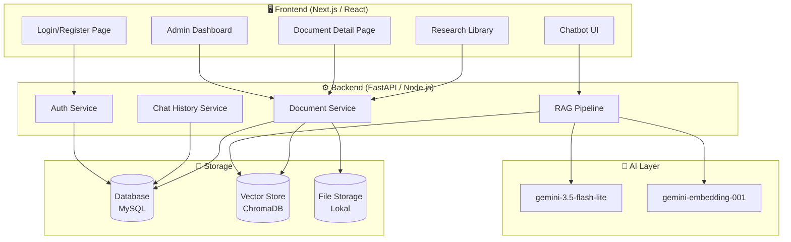
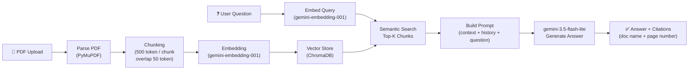
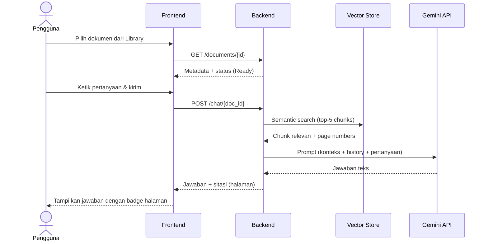
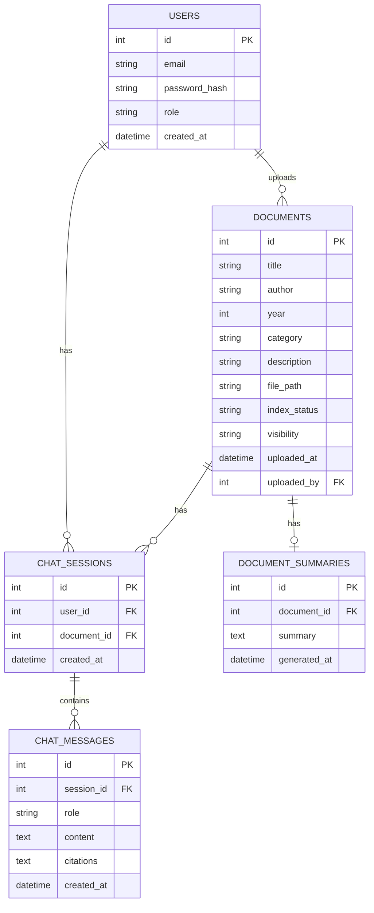
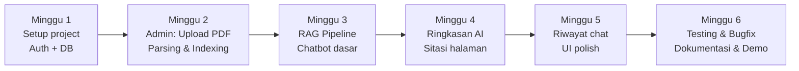

# 📄 Product Requirements Document (PRD)
# TemaniResearch — AI-Powered Research Document Assistant

**Versi**: 1.0  
**Tanggal**: 17 November 2026  
**Mata Kuliah**: Sistem Informasi berbasis Kecerdasan Buatan  
**Status**: Reviewed

---

## 1. Ringkasan Eksekutif

**TemaniResearch** adalah sistem informasi berbasis AI yang memungkinkan pengguna mengeksplorasi koleksi dokumen penelitian (PDF) secara interaktif. Admin mengelola repository dokumen terpusat; pengguna dapat memilih dokumen, meminta ringkasan, dan berdiskusi dengan chatbot yang menjawab *berdasarkan isi dokumen terpilih* menggunakan teknik **Retrieval-Augmented Generation (RAG)**. Setiap jawaban disertai referensi sumber dan nomor halaman.

> [!IMPORTANT]
> Sistem menggunakan **Gemini API (Free Tier)** sebagai backbone AI, dengan batas rate limit yang perlu dikelola secara hati-hati pada sisi backend.

---

## 2. Latar Belakang & Rumusan Masalah

Mahasiswa dan peneliti menghabiskan waktu yang tidak efisien untuk membaca dokumen PDF secara linear. Pencarian kata kunci biasa tidak memahami konteks pertanyaan. Penggunaan AI generatif tanpa sumber yang jelas berisiko menghasilkan jawaban yang tidak dapat diverifikasi (*hallucination*).

| # | Rumusan Masalah |
|---|---|
| 1 | Bagaimana menyediakan repository penelitian yang rapi dan mudah dikelola admin? |
| 2 | Bagaimana membantu pengguna memahami isi PDF secara cepat melalui ringkasan dan tanya-jawab? |
| 3 | Bagaimana memastikan jawaban AI merujuk pada dokumen dan halaman yang relevan? |
| 4 | Bagaimana menyimpan riwayat percakapan agar pengguna dapat melanjutkan eksplorasi? |

---

## 3. Tujuan Produk

| # | Tujuan |
|---|---|
| 1 | Membangun sistem repository dokumen PDF dengan metadata yang dikelola admin |
| 2 | Mengimplementasikan chatbot RAG untuk menjawab pertanyaan berdasarkan dokumen terpilih |
| 3 | Menyediakan ringkasan AI untuk mempercepat pemahaman dokumen |
| 4 | Menampilkan referensi sumber dan nomor halaman pada hasil AI |
| 5 | Menyediakan riwayat chat per pengguna dan dokumen |

---

## 4. Target Pengguna

| Peran | Deskripsi |
|---|---|
| **Admin** | Mengelola **repository publik**: upload, edit metadata, hapus dokumen PDF yang dapat diakses semua pengguna |
| **Pengguna (Mahasiswa/Peneliti)** | Menelusuri library publik, mengunggah jurnal pribadi ke **personal library**, membaca ringkasan, dan berdiskusi dengan chatbot |

---

## 5. Ruang Lingkup (Scope)

### ✅ In Scope (MVP)
- Autentikasi (login/register) dengan role Admin & Pengguna
- Dashboard Admin: upload PDF, input metadata (judul, penulis, tahun, kategori/tag, abstrak) ke **repository publik**
- **User Upload (Personal Library):** pengguna dapat mengunggah PDF jurnal pribadi yang hanya bisa diakses oleh dirinya sendiri
- Research Library: daftar dokumen publik (dari Admin) + dokumen pribadi pengguna, dengan filter dan pencarian
- Halaman Detail Dokumen: tampilan metadata, tombol ringkasan, dan chat
- Fitur **Ringkasan AI**: generate ringkasan dokumen dengan Gemini API
- **Chatbot RAG**: tanya-jawab berbasis isi dokumen terpilih dengan sitasi halaman
- Riwayat percakapan per pengguna per dokumen

### ❌ Out of Scope (MVP)
- Kolaborasi multi-user secara real-time
- Perbandingan lintas dokumen (cross-document Q&A)
- Mobile native app (Android/iOS)
- Ekspor hasil chat ke PDF/Word

---

## 6. Fitur & Requirements

### 6.1 Autentikasi & Manajemen Role

| ID | Requirement |
|---|---|
| AUTH-01 | Pengguna dapat register dengan email & password |
| AUTH-02 | Pengguna dapat login dan mendapatkan session |
| AUTH-03 | Sistem membedakan role **Admin** dan **User** |
| AUTH-04 | Admin dapat melihat daftar pengguna terdaftar |

---

### 6.2 Manajemen Dokumen (Admin)

| ID | Requirement |
|---|---|
| DOC-01 | Admin dapat mengunggah file PDF (maks. 20 MB per file) |
| DOC-02 | Admin mengisi metadata: judul, penulis, tahun terbit, kategori, deskripsi singkat |
| DOC-03 | Admin dapat mengedit metadata dokumen yang sudah ada |
| DOC-04 | Admin dapat menghapus dokumen (beserta vector index-nya) |
| DOC-05 | Setelah upload, sistem otomatis mem-parsing dan meng-chunk PDF untuk indexing |
| DOC-06 | Status indexing ditampilkan (Processing / Ready / Failed) |

---

### 6.3 Research Library (Pengguna)

| ID | Requirement |
|---|---|
| LIB-01 | Pengguna melihat daftar dokumen **publik** (dari Admin) dan **dokumen pribadi** miliknya sendiri dalam satu halaman library |
| LIB-02 | Pengguna dapat mencari dokumen berdasarkan judul atau penulis |
| LIB-03 | Pengguna dapat memfilter dokumen berdasarkan kategori/tag, tahun, dan **sumber** (Publik / Pribadi) |
| LIB-04 | Dokumen yang belum selesai di-index (status bukan Ready) tidak dapat dibuka untuk chat |

---

### 6.3b Upload Jurnal Pribadi (Pengguna)

| ID | Requirement |
|---|---|
| ULIB-01 | Pengguna dapat mengunggah file PDF jurnal pribadi (maks. 20 MB) |
| ULIB-02 | Pengguna mengisi metadata minimal: judul, penulis, tahun |
| ULIB-03 | Dokumen yang diunggah pengguna **hanya bisa diakses oleh pengguna tersebut** (private) |
| ULIB-04 | Sistem otomatis mem-parsing dan meng-chunk PDF setelah upload, sama seperti alur Admin |
| ULIB-05 | Pengguna dapat menghapus dokumen pribadinya sendiri |
| ULIB-06 | Status indexing ditampilkan (Processing / Ready / Failed) |

---

### 6.4 Ringkasan AI

| ID | Requirement |
|---|---|
| SUM-01 | Pengguna dapat meminta ringkasan dokumen dengan satu klik |
| SUM-02 | Ringkasan di-generate menggunakan Gemini API berdasarkan chunk awal dokumen |
| SUM-03 | Ringkasan mencakup: tujuan, metodologi, temuan utama, dan kesimpulan |
| SUM-04 | Ringkasan di-cache agar tidak memanggil API berulang untuk dokumen yang sama |
| SUM-05 | Ringkasan ditampilkan dalam Bahasa Indonesia |

---

### 6.5 Chatbot RAG

| ID | Requirement |
|---|---|
| CHAT-01 | Pengguna dapat mengajukan pertanyaan bebas (natural language) tentang dokumen terpilih |
| CHAT-02 | Sistem melakukan semantic search pada vector index dokumen untuk mendapatkan chunk relevan |
| CHAT-03 | Chunk relevan dikirim sebagai konteks (context window) ke Gemini API |
| CHAT-04 | Jawaban AI menampilkan **sitasi**: nama dokumen + nomor halaman sumber |
| CHAT-05 | Jika pertanyaan di luar isi dokumen, AI menjawab: *"Informasi ini tidak ditemukan dalam dokumen."* |
| CHAT-06 | Riwayat percakapan (conversation history) dikirim ke API untuk menjaga konteks multi-turn |
| CHAT-07 | Pengguna dapat memulai sesi chat baru (clear history) kapan saja |

---

### 6.6 Riwayat Chat

| ID | Requirement |
|---|---|
| HIST-01 | Riwayat chat disimpan di database per pengguna per dokumen |
| HIST-02 | Pengguna dapat melihat kembali percakapan sebelumnya |
| HIST-03 | Pengguna dapat menghapus riwayat chat untuk dokumen tertentu |

---

## 7. Arsitektur Sistem

---

## 8. Tech Stack (Rekomendasi)

| Layer | Pilihan | Keterangan |
|---|---|---|
| **Frontend** | Next.js 14 (React) | UI responsif, SSR |
| **Backend** | FastAPI (Python) | Native support library AI/NLP |
| **Database** | MySQL | Familiar, banyak dipakai di kampus, mudah di-manage |
| **Vector Store** | ChromaDB | Gratis, lokal, `pip install chromadb`, zero config |
| **PDF Parser** | PyMuPDF (`fitz`) | Ekstrak teks + nomor halaman |
| **Embedding** | `gemini-embedding-001` | Gemini Free Tier, multilingual, dimensi fleksibel |
| **LLM** | `gemini-3.5-flash-lite` | Gemini Free Tier, ultra-low latency, 1M token context |
| **Auth** | JWT (stateless) | Sederhana untuk MVP |

> [!TIP]
> Gunakan `gemini-3.5-flash-lite` untuk chat dan ringkasan — ultra-low latency, context window 1 juta token, dan lebih hemat quota. Cocok untuk RAG Q&A real-time.

> [!WARNING]
> **Gemini Free Tier Rate Limit**: 15 RPM (request per minute) untuk `gemini-3.5-flash-lite`. Implementasikan **request queue** atau debounce di backend agar tidak hit limit saat banyak pengguna.

> [!CAUTION]
> **Jaga konsistensi MySQL ↔ ChromaDB**: Saat dokumen dihapus, pastikan chunk vektornya ikut dihapus dari ChromaDB. Buat satu fungsi `delete_document()` yang menghapus keduanya secara atomik agar tidak ada "ghost chunk" dari dokumen yang sudah tidak ada.

---

## 9. Alur RAG Pipeline

---

## 10. User Flow Utama

### Flow: Pengguna Bertanya ke Chatbot

---

## 11. Desain Database (Skema Dasar)

---

## 12. API Endpoints (Rencana)

| Method | Endpoint | Deskripsi | Role |
|---|---|---|---|
| `POST` | `/auth/register` | Daftar akun baru | Public |
| `POST` | `/auth/login` | Login, return JWT | Public |
| `GET` | `/documents` | Ambil daftar dokumen publik + dokumen pribadi milik user | User, Admin |
| `POST` | `/documents` | Upload PDF + metadata ke repository publik | Admin |
| `POST` | `/documents/personal` | Upload PDF jurnal pribadi | User |
| `DELETE` | `/documents/personal/{id}` | Hapus dokumen pribadi milik sendiri | User |
| `PUT` | `/documents/{id}` | Edit metadata | Admin |
| `DELETE` | `/documents/{id}` | Hapus dokumen | Admin |
| `GET` | `/documents/{id}/summary` | Ambil/generate ringkasan AI | User |
| `GET` | `/chat/{doc_id}/sessions` | Ambil semua sesi chat | User |
| `POST` | `/chat/{doc_id}` | Kirim pesan, dapat balasan AI | User |
| `DELETE` | `/chat/sessions/{session_id}` | Hapus sesi chat | User |

---

## 13. UI/UX Wireframe (Deskriptif)

### Halaman Research Library
- **Header**: Logo TemaniResearch + tombol Login/Profile
- **Sidebar**: Filter kategori, filter tahun
- **Main**: Grid card dokumen — tiap card: judul, penulis, tahun, kategori badge, tombol "Buka"
- **Search bar**: Di atas grid

### Halaman Detail Dokumen
- **Kiri**: Metadata lengkap dokumen + tombol "📝 Generate Ringkasan"
- **Kanan**: Panel chat dengan input pertanyaan, daftar pesan, dan badge halaman sitasi di tiap jawaban

### Dashboard Admin
- **Tabel dokumen**: judul, status index, aksi (edit/hapus)
- **Tombol Upload**: Form modal dengan field metadata + file picker

---

## 14. Kriteria Penerimaan (Acceptance Criteria)

| Fitur | Kriteria Sukses |
|---|---|
| Upload PDF | File tersimpan, metadata tersimpan di DB, indexing berjalan otomatis |
| Ringkasan AI | Ringkasan dihasilkan dalam < 15 detik, mencakup 4 aspek utama |
| Chatbot RAG | Jawaban relevan dengan isi dokumen, sitasi halaman muncul |
| Riwayat Chat | Chat sebelumnya dapat diakses kembali setelah reload halaman |
| Out-of-scope Q | AI menjawab "tidak ditemukan dalam dokumen" jika konteks tidak relevan |

---

## 15. Risiko & Mitigasi

| Risiko | Dampak | Mitigasi |
|---|---|---|
| Rate limit Gemini Free Tier | Chat gagal saat traffic tinggi | Implementasi antrian request + notifikasi "sedang diproses" |
| PDF kompleks (tabel, gambar) | Ekstraksi teks tidak sempurna | Gunakan PyMuPDF, dokumentasikan limitasi |
| Kualitas embedding rendah | Retrieval chunk tidak relevan | Eksperimen chunk size & overlap, uji dengan beberapa pertanyaan sampel |
| Data sensitif dalam PDF | Risiko privasi | Batasi akses dokumen hanya untuk pengguna login |

---

## 16. Rencana Pengembangan (Timeline)

| Minggu | Target |
|---|---|
| 1 | Setup repo, autentikasi, skema database |
| 2 | Admin dashboard, upload PDF, parsing & vector indexing |
| 3 | RAG pipeline, chatbot dasar (Q&A dari dokumen) |
| 4 | Ringkasan AI, tampilan sitasi halaman |
| 5 | Riwayat chat, UI/UX polish, Research Library |
| 6 | Testing menyeluruh, bugfix, laporan & demo |

---

## 17. Definisi Selesai (Definition of Done)

- [ ] Semua endpoint API berfungsi dan teruji
- [ ] Admin dapat mengelola dokumen end-to-end
- [ ] Chatbot menjawab pertanyaan dengan sitasi halaman yang akurat
- [ ] Ringkasan AI ter-cache dan tidak hit API berulang
- [ ] Riwayat percakapan tersimpan dan dapat diakses kembali
- [ ] Aplikasi dapat dijalankan secara lokal dengan dokumentasi setup
- [ ] Laporan/presentasi tugas akhir tersedia

---

